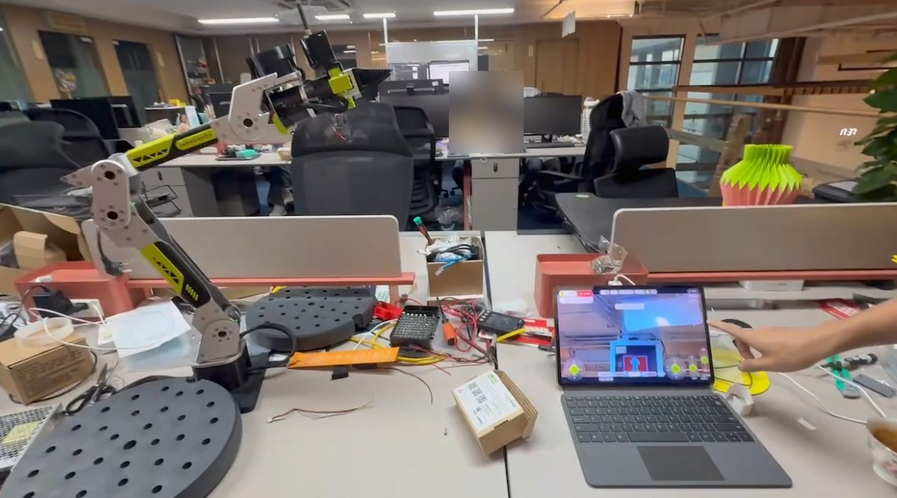
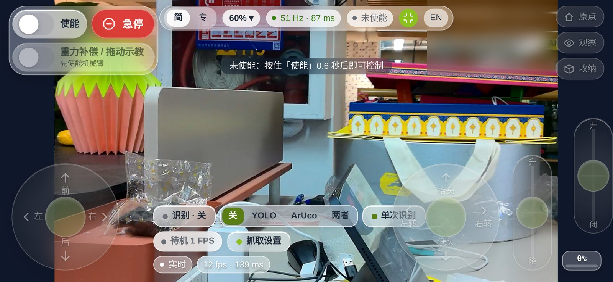
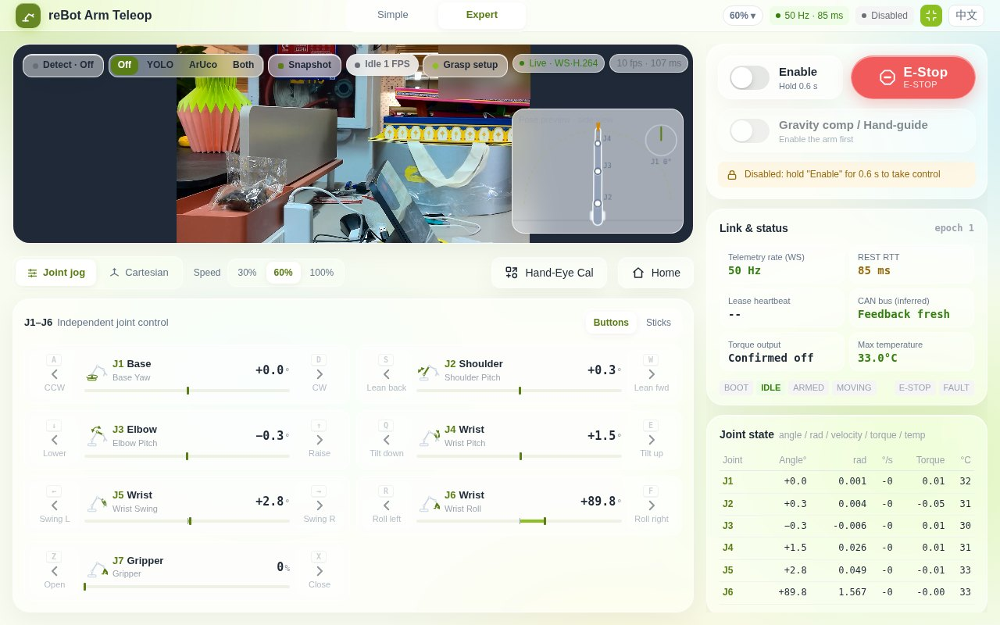

# rebot-armd

<div align="center">

### 用一颗 40 mm 的摄像头驱动 7 电机机械臂

**`armd` 是一个 4 MB 的 Rust 运行时。在单核 RISC-V 的摄像头芯片上，它以 50 Hz 控住全部 7 个电机，只用 7 % 的 CPU 和 3.7 MB 内存，同时提供网页驾驶舱和 AI Agent 接口；同一颗芯片还在推视频流、跑目标检测。**

[](#hardware)
[](#hardware)
[](#hardware)
[](https://www.rust-lang.org)
[](LICENSE)
[](https://github.com/Seeed-Solution/rebot-armd/actions)
[](https://github.com/Seeed-Projects/reBot-DevArm)
[](https://www.seeedstudio.com)

[English](./README.md) | 中文



<sub>平板上的网页驾驶舱遥控 reBot B601-DM；腕部的 reCamera 运行 armd 和视觉进程。</sub>

</div>

---

`armd` 是一个机械臂控制运行时：固定周期的控制循环与安全监督器、电机驱动、8765 端口上的 HTTP/WebSocket 服务，打包为单个静态二进制（RISC-V 版 4.1 MiB）。控制器上不需要 Python、ROS 或 GPU。

参考平台展示了控制器可以小到什么程度：`armd` 与摄像头自带的视频和检测服务一起运行在 Seeed reCamera（SG2002 RISC-V SoC，Linux 可用内存约 180 MB）上，通过 reCamera B4 底板的 CAN 总线驱动 reBot B601-DM 的 7 个达妙电机。同一份代码可在 x86_64 Linux 上编译并通过测试（CI）；其他主机与机械臂的验证状态见 [硬件](#硬件)。

| | 参考平台实测（Seeed reCamera + reBot B601-DM） |
|---|---|
| 控制器 | Seeed reCamera：SG2002，**1 个 RISC-V 核**（SoC 规格 1 GHz），Linux 可见内存 **180 MB**，机身 40 × 40 mm |
| `armd` 二进制 | **4.1 MB**，静态链接，无需 Python、ROS 或 GPU；安装包 `.deb` **2.0 MB** |
| `armd` 内存 | 常驻 **3.7 MB**（VmRSS） |
| `armd` CPU | 7 个电机全部上力矩、50 Hz 保持时占 **7.0 %**；未上力矩时 4.5 %（均为 10 s 平均） |
| 整颗芯片（上力矩时） | 忙碌 **31 %**，包括摄像头的视频与检测，约 69 % 的 CPU 空闲 |
| 机械臂 | **7** 个达妙电机（6 关节 + 夹爪），CAN 1 Mbit/s，控制循环 **50 Hz** |
| 同一颗芯片同时运行 | `rebot-vision` 提供的 H.264 视频、YOLO 目标检测与 ArUco 标记，按需运行（见[视觉](#视觉recamera-套件)） |

`armd` 提供：

- 单文件网页驾驶舱，适用于手机、平板和桌面（摇杆、笛卡尔控制、摄像头视频、识别叠加、手眼标定、点框抓取）；
- 用于观测的 REST API 和用于控制的 WebSocket API，执行器指令只接受持有控制租约的连接；
- 面向 agent 的高层动作（`move_to`、`move_relative`、`gripper`、`grasp`、基于命名姿态的 `move_to_pose`），由 [rebot-companion](https://github.com/Seeed-Solution/rebot-companion) 及其 MCP 服务器使用；
- 客户端无法放宽的服务端限制：含禁入盒的笛卡尔工作空间与 profile 速度上限；故障带机器可读的故障码；
- 把关节状态与指令录制为 Parquet 文件；
- 目标检测（YOLO，跑在 TPU）与带 3D 位姿的 ArUco 标记（跑在 CPU），只在调用方请求时运行（[视觉](#视觉recamera-套件)）；
- 用于拖动示教的重力补偿模式，已在 B601-DM 上实机验证。

> 本软件会驱动真实的机械臂。在硬件上运行前请先阅读 [安全](#安全)。

**命名**：仓库名 `rebot-armd`，Cargo 包与二进制名 `armd`，在 reCamera 上安装它的 Debian 包名 `rebot-teleop`（init 脚本 `/etc/init.d/K92rebot-teleop`，数据目录 `/usr/share/rebot-teleop`）。

---

## 目录

- [硬件](#硬件)
- [架构](#架构)
- [在 reCamera 上安装](#在-recamera-上安装)
- [从源码构建](#从源码构建)
- [网页驾驶舱](#网页驾驶舱)
- [视觉（reCamera 套件）](#视觉recamera-套件)
- [API 概览](#api-概览)
- [Agent 与 MCP 集成](#agent-与-mcp-集成)
- [示教片段录制（Parquet）](#示教片段录制parquet)
- [配置与命令行](#配置与命令行)
- [接线（reCamera B4 CAN 底板）](#接线recamera-b4-can-底板)
- [安全](#安全)
- [开发](#开发)
- [致谢](#致谢)
- [许可证](#许可证)

---

## 硬件

### 平台

| 平台 | 状态 |
|---|---|
| Seeed reCamera（SG2002，RISC-V，musl 静态编译）+ B4 CAN 底板 | 已用 reBot B601-DM 真机验证（参考平台） |
| x86_64 Linux | CI 中可编译并通过 `cargo test`（使用 `mock` 从动臂）；未接真机运行 |
| 其他带 SocketCAN 接口（例如显示为 `can0` 的 USB-CAN 适配器）或串口总线的 Linux 主机 | 按代码应可运行；未验证 |

### 机械臂

已在真机上验证：

| 项目 | 说明 |
|---|---|
| 机械臂 | reBot B601-DM：6 个臂关节和 1 个夹爪，均为达妙电机；armd 中共 7 个关节（索引 6 为夹爪） |
| 控制器 | Seeed reCamera（SG2002）+ B4 CAN 底板，`can0` 1 Mbit/s（由 init 脚本配置） |
| 电机模式 | 达妙 `POS_VEL`（位置 + 速度上限），默认模式，也是命令行唯一可选的模式 |

验证中（代码中已有驱动，未在真实机械臂上运行，暂不属于支持范围）：

| `--follower` | 驱动 | 总线 | 说明 |
|---|---|---|---|
| `rebot-rs` | RobStride（MIT 模式，29 位 CAN ID） | SocketCAN | 6 关节；无使能确认，因此自动断力矩和清除故障会被拒绝 |
| `so-arm101` | 飞特 STS（SO-ARM101） | 串口，1,000,000 波特 | 6 关节；有位置、速度、温度反馈，无力矩与使能反馈 |
| `fashionstar`、`star-arm102` | FashionStar | 串口，115,200 波特 | 6 关节；驱动未声明任何反馈能力 |

`mock`（进程内仿真，默认值）用于测试和无机械臂时的界面开发。

验证中驱动的协议编码由单元测试覆盖（`tests/test_protocol_vectors.rs`、`tests/test_driver_capabilities.rs`）。它们使用通用 6 关节 profile，没有运动学和工作空间，笛卡尔动作返回 `UNSUPPORTED`。达妙驱动另有带重力前馈的 MIT 模式，但只能在代码中启用（`DamiaoArmDriver::with_control_mode`），命令行和 profile 都不能选择。重力补偿模式在运行时把 J1–J6 切到 MIT 再切回（见[网页驾驶舱](#网页驾驶舱)），该切换已在 B601-DM 上实机验证。

TODO / 路线图：

- [ ] 在真实机械臂上验证 `rebot-rs`（RobStride）、`so-arm101`（飞特 STS）和 `fashionstar` / `star-arm102`（FashionStar），并提供带运动学和工作空间的 profile。
- [x] 在 B601-DM 上验证重力补偿模式（达妙 MIT 切换、重力前馈）（[核实清单](docs/control_safety_contract.md#hardware-verification-checklist--实机核实清单)）。
- [ ] 主从示教（未实现；`--leader` / `--leader-port` 会被拒绝）。

---

## 架构

```text
 浏览器驾驶舱 / rebot-companion / 脚本
        │  HTTP GET（观测）           WebSocket /api/v1/ws（租约、指令、遥测）
        ▼
┌───────────────────────────── armd :8765 ──────────────────────────────┐
│ axum HTTP/WS 服务 ── 识别代理 ──► 摄像头检测服务 :8090                 │
│        │                                                               │
│ ArmSupervisor（单把锁）                                                │
│   租约 + epoch 校验 → 规划（五次多项式 / S 曲线、笛卡尔 IK）           │
│   安全状态机：Booting、Idle、Armed、Moving、EStop、Fault               │
│   看门狗、关节限位、工作空间盒、限速、跟踪误差                         │
│        │ 控制 tick，默认 50 Hz（权限允许时 SCHED_FIFO 50）             │
│ 驱动：达妙 / RobStride（SocketCAN），飞特 / FashionStar（串口）        │
└────────────────────────────────────────────────────────────────────────┘
        │ CAN 1 Mbit/s
        ▼
   reBot B601-DM 电机
```

- **控制循环**：固定周期 tick（`control_frequency_hz`，内置 profile 为 50 Hz，允许范围 1..1000）。tick 晚于 80 ms 时锁存安全保持，不继续执行旧轨迹。视频不经过 armd：驾驶舱用 JMuxer 直接播放摄像头的 H.264 WebSocket 流（`ws://<host>:8001/`）。
- **租约**：执行器权限属于发送了 `acquire_lease` 并持续发送 `heartbeat` 的 WebSocket 连接（租约超时 2500 ms）。每条 `command` 都带租约 `generation`、当前安全 `epoch_id` 和严格递增的 `request_id`。REST 执行器路由（`torque`、`motion/*`、`action/*`、`clear_fault`）返回 `409 LEASE_REQUIRED`，不执行动作。急停例外：REST 与 WebSocket 都不需要租约。其他客户端可用 `force` 接管，接管后在机械臂稳定前拒绝运动（`HANDOVER_SETTLING`）。
- **安全层**（详见 [docs/control_safety_contract.md](docs/control_safety_contract.md)）：关节位置、速度、加速度限位；`max_temperature` 温度保护（内置 profile 为 70 °C）；反馈新鲜度（250 ms）；跟随误差故障（`max_error_rad` 0.5，持续 500 ms）及动作的 `TRACKING_STALL`；规划运动限速（`planned_max_velocity`，rebot-dm 为 0.45 rad/s）；servo 流式限速与领先量上限（`servo_max_velocity`、`servo_max_lead_rad` 0.2），关节跟不上时保持位置而不报 Fault，并在观测 `motion_limit` 中报告；笛卡尔工作空间检查（地面、包围盒、伸展范围）；租约看门狗自动收纳；不在收纳位时拒绝断力矩（`ARM_NOT_AT_RESTING_POSE`），避免机械臂下坠。

### 核心、套件与 agent

仓库分三层：**核心**（`armd`，即本 crate）；**套件**，把核心适配到一种 控制器 + 机械臂 + 相机 + 支架 组合（`kits/recamera-b601dm/` 是官方参考套件，`kits/_template/` 是第三方套件的起点）；**agent 层**（rebot-companion、驾驶舱），只使用 armd 的 API。核心与套件通过四个带版本的契约交互：机械臂 profile JSON（`--config`，`profile_version` 1）、感知服务 API（检测代理）、能力发现（观测 schema 中的 `capabilities`，版本 4）和打包。`./scripts/build_deb.sh --flavor lite` 只构建核心，默认的 `--flavor recamera` 构建核心加 reCamera 套件。详见 [docs/architecture.zh-CN.md](docs/architecture.zh-CN.md)。

---

## 在 reCamera 上安装

构建安装包（见 [交叉编译](#交叉编译到-recamera)）或使用发布的 `.deb`，复制到摄像头并安装。`192.168.42.1` 是 reCamera 的 USB 网络地址；连接本包启动的 Wi-Fi 热点时，摄像头地址为 `192.168.16.1`。

```bash
scp dist/rebot-teleop_1.3.8_riscv64.deb root@192.168.42.1:/tmp/
ssh root@192.168.42.1 "dpkg -i /tmp/rebot-teleop_1.3.8_riscv64.deb && /etc/init.d/K92rebot-teleop restart"
```

安装内容：

| 路径 | 内容 |
|---|---|
| `/usr/bin/armd`（软链接 `/usr/local/bin/armd`） | 守护进程 |
| `/usr/bin/rebot-vision` | 相机进程：H.264 视频 `:8001`、YOLO / ArUco 接口 `:8090`（[kits/recamera-b601dm/vision](kits/recamera-b601dm/vision/)） |
| `/etc/init.d/K92rebot-teleop`（仅在没有 reCamera 控制台的设备上由 `postinst` 添加 `S92rebot-teleop`） | init 脚本：Wi-Fi、`can0` 配置、armd 与 rebot-vision 的启动 / 停止 |
| `/usr/share/rebot-teleop/` | 驾驶舱 `index.html`、URDF、reCamera 应用列表用的应用清单 `rebot-teleop.json`、机械臂 profile `profile/rebot-b601dm.json` |
| `/userdata/local/apps/rebot-teleop.json` | 由 `postinst` 复制 |

init 脚本启动 `armd --follower rebot-dm --follower-port can0 --port 8765`（该文件存在时再加 `--config /usr/share/rebot-teleop/profile/rebot-b601dm.json`），把 `can0` 设为 1 Mbit/s，并在 `wlan1` 上启动 Wi-Fi 热点（SSID `reCamera-Arm-Teleop`，默认密码 `12345678`，地址 `192.168.16.1`），也可以连接已有的 Wi-Fi 网络。这些值从 `/userdata/local/apps/rebot-teleop.config.json` 读取（`arm.follower_model`、`arm.serial_port`、`port`、`network.ap_ssid`、`network.ap_password`、`network.ap_ip`、`network.ap_band`、`network.ap_channel`、`network.sta_ssid`、`network.sta_password`）。在实验室以外使用前，**请修改默认热点密码**。日志在 `/var/log/rebot-teleop.log`。

armd 之后 init 脚本启动 `rebot-vision`（nice 10，由 `/usr/share/rebot-teleop/rebot-vision-run` 退避重启，日志 `/var/log/rebot-vision.log`）。启动前用其他相机应用自己的 init 脚本停止正在运行的相机应用（例如 `yolo-detector`、`aruco-detector`），不禁用、不卸载其他应用。在 reCamera 控制台启用其他相机应用会停止本应用。视觉配置：`/userdata/rebot-teleop/vision.json`。安装包不含 YOLO 模型，使用设备上已有的模型（见 vision README）；没有模型时 YOLO 模式不可用，ArUco 可用。

热点默认使用 5 GHz（`network.ap_band: "5g"`，信道 44，802.11n/ac，20 MHz 带宽）。把 `network.ap_band` 设为 `"2g4"` 改用 2.4 GHz（信道 6）。`network.ap_channel` 指定信道，`0` 或不设置时使用默认信道。启动后若 hostapd 未在 5 GHz 信道上运行（用 `iw dev wlan1 info` 检查），init 脚本改用 2.4 GHz 信道 6 重新启动，并把回退记录到 syslog。

安装或升级后，若本应用是控制台当前的活动应用（或设备没有控制台），`postinst` 会启动它。驾驶舱地址：`http://<摄像头地址>:8765/`。

armd 通过 `http://127.0.0.1:8090` 访问视觉进程（可用 `ARMD_DETECTOR_URL` 修改）。`--flavor lite` 不含视觉进程，此时识别、标定和抓取不可用，驾驶舱其他功能正常。

---

## 从源码构建

需要 Rust 工具链（stable，edition 2021）。Node.js 只在运行网页自测时需要。

```bash
cargo build --release
cargo test

# 用仿真机械臂运行，然后打开 http://localhost:8765/
cargo run --release -- --follower mock
```

在带 CAN 适配器的 Linux PC 上也可以驱动真实机械臂：`cargo run --release -- --follower rebot-dm --follower-port can0`（先把 `can0` 以 1 Mbit/s 启用）。目前只测试过 reCamera 方案。

### 交叉编译到 reCamera

目标 `riscv64gc-unknown-linux-musl`，静态链接。链接器为 `rust-lld`；C 运行时库来自 [sophgo/host-tools](https://github.com/sophgo/host-tools) 中的 SG2002 musl 工具链（`gcc/riscv64-linux-musl-x86_64` 下的 `lib64v0p7_xthead/lp64d` 库）。只用到其中的库文件，因此 x86_64 工具链在 arm64 构建主机上同样可用。

```bash
rustup target add riscv64gc-unknown-linux-musl
git clone --depth 1 https://github.com/sophgo/host-tools   # 检出后 9.3 GB
export RECAMERA_TOOLCHAIN=$PWD/host-tools/gcc/riscv64-linux-musl-x86_64

./scripts/build_deb.sh --flavor lite  # 只含 armd，不含 reCamera 套件文件
# -> target/riscv64gc-unknown-linux-musl/release/armd
# -> dist/armd-lite_0.1.0_riscv64.tar.gz（armd、LICENSE、THIRD_PARTY_NOTICES.md）
```

`--flavor recamera`（deb 包）还需要 `rebot-vision`（基于 SG2002 SDK 构建的 C++ 程序）。最简单的方式是使用 [GitHub release](https://github.com/Seeed-Solution/rebot-armd/releases/tag/v1.3.4) 中的预编译二进制：

```bash
V=1.3.4
curl -LO https://github.com/Seeed-Solution/rebot-armd/releases/download/v$V/rebot-vision-$V-riscv64
curl -LO https://github.com/Seeed-Solution/rebot-armd/releases/download/v$V/SHA256SUMS
sha256sum --ignore-missing -c SHA256SUMS

REBOT_VISION_BIN=$PWD/rebot-vision-$V-riscv64 \
./scripts/build_deb.sh 1.3.8          # 版本参数可省略（默认取 debian/control）
# -> dist/rebot-teleop_1.3.8_riscv64.deb
```

如需从源码构建 `rebot-vision`，设置 `RECAMERA_DOCKER=<容器名>`（一个正在运行的 `sophgo/tpuc_dev:v3.1` 容器，`/recamera` 下有 host-tools、reCamera OS SDK 和 `sscma-example-sg200x`），`build_deb.sh` 会调用 `scripts/build_vision.sh`。逐步命令见 [kits/recamera-b601dm/vision/README.md](kits/recamera-b601dm/vision/README.md#build)。

`--flavor recamera`（默认）构建 reCamera 运行时：armd 加上 [reCamera B601-DM 套件](kits/recamera-b601dm/)的文件（init 脚本、应用列表 manifest、URDF；源文件在 `kits/recamera-b601dm/packaging/`）。`--flavor lite` 构建最小运行时：同一个 `armd` 二进制打成 tarball，不含 init 脚本和套件文件（版本默认取 `Cargo.toml`）。

`build_deb.sh` 需要 `cargo` 和 `dpkg-deb`。它根据 `RECAMERA_TOOLCHAIN` 生成 `RUSTFLAGS`（旧变量名 `REC_TOOLCHAIN` / `RISCV_SYSROOT` 仍可用）；如果自行设置了 `RUSTFLAGS`，则按原样使用。`.cargo/config.toml` 只保存目标级的链接器设置。

v1.3.4 release 产物的大小（release profile：`opt-level = "z"`、fat LTO、strip）：`armd` 4,465,760 字节（4.3 MiB），`rebot-vision` 951,040 字节（929 KiB），`.deb` 2,702,126 字节（2.6 MiB，gzip）。设备上的内存占用未测。

---

## 网页驾驶舱

`src/api/index.html` 是不依赖外部资源的单个 HTML 文件，嵌入二进制并在 `/` 提供。JMuxer（`/assets/jmuxer.min.js`）播放摄像头视频。界面支持中文和英文（页头切换）。

<p align="center">
  
  
</p>
<sub>截图来自真机 reCamera 的实时视频，力矩关闭。左：手机横屏简化模式；右：桌面专家模式（英文界面）。</sub>

- **简洁 / 专家模式**：简洁模式显示视频和叠加在视频上的摇杆，在 7 自由度机械臂上固定使用视角坐标系；专家模式另有视角 / 基座坐标系切换、关节 / 笛卡尔模式切换、侧视姿态预览、链路状态、关节状态表、数据集录制和键盘快捷键。
- **关节点动**：两个虚拟摇杆（J1/J2、J3/J5、夹爪）以及键盘。
- **笛卡尔控制**，两种坐标系：
  - *视角坐标系*：方向跟随摄像头画面（摄像头安装在 J6 之后）。移动摇杆（沿视线前后 / 画面左右）和升降在浏览器中用 6 关节 IK 求解，保持摄像头朝向不变；视角摇杆只动手腕（上下 = J4，左右 = J5），J1–J3 和 J6 不动；
  - *基座坐标系*：方向跟随机械臂基座坐标轴。
  目标跟随实测位姿，经 WebSocket 租约流式发送。
- **识别叠加**：在视频上绘制 YOLO 检测框和 ArUco 标记，可选 YOLO、ArUco 或两者；只有叠加开启且页面可见时，页面才持有视觉订阅。另有单次快照。
- **手眼标定抽屉**：眼在手上（摄像头装在夹爪上）或眼在手外（固定摄像头），使用 ArUco 标记；采集位姿、求解、导出 rebot-companion 的 `HandEyeCalibration.load_result` 可读取的 JSON。
- **点框抓取**：开启识别后点一个框并确认，armd 执行 `grasp` 动作（张开、俯视接近、闭环图像对中、J6 对齐 0° / 90°、下降、夹紧并判定、抬起）。任何摇杆、按键、停止或急停都会中止。抓取设置（桌面高度、夹爪位置像素、接近与抓取高度、相机俯角）由 armd 保存。目前只在仿真和截图测试中验证过；需要在真机上确认的项目见 [docs/plan_tap_to_grasp.md](docs/plan_tap_to_grasp.md)。
- **重力补偿 / 拖动示教**：按住开关 0.6 秒，J1–J6 进入漂浮状态（MIT 模式，kp = 0，带阻尼，以 URDF 重力力矩为前馈，1 秒内渐入）；夹爪保持位置控制。开启期间摇杆、按键和预设不发送指令，夹爪按键发送张开 / 闭合动作，横幅显示渐入进度、录制开关和退出按钮。退出、停止、急停、租约丢失、故障、反馈超时、超速等退出原因都会在实测位姿锁定机械臂，并以提示条显示原因。超速阈值：J1–J3 为 1.5 rad/s，J4–J6 为 3.0 rad/s。在 B601-DM 上测试的五种退出方式（退出、停止、接管、急停、客户端断开）均把机械臂保持在 1.5 mrad 以内；一段 30 秒拖动示教录制得到 1509 帧。
- **急停**按钮、故障显示与清除、长按使能力矩、收纳。armd 提供 `capabilities.fault_codes` 时，故障显示用一句话说明 `observation.fault.code`，并给出清除前要检查的内容（例如 `BUS_LOSS`：检查电机线缆和电源）。
- **碰撞保护**（仅在 `capabilities.collision_guard` 为 true 时显示）：`observation.collision.active` 期间，顶部红色横幅显示受阻关节、残余力矩和自动恢复倒计时，不能关闭；升级为 `COLLISION` 故障后显示清除故障按钮。设置抽屉（顶栏齿轮）可开关碰撞保护并选择灵敏度（低 / 中 / 高）；阈值尚未在机械臂上标定。专家模式显示 J1–J6 残余力矩条（低于阈值 50 % 为绿色，50–100 % 为黄色，触发时为红色）。
- **点位抽屉**（仅在 `capabilities.poses` 为 true 时显示）：用名称（`^[A-Za-z0-9_-]{1,64}$`）记录当前位置，按驾驶舱速度前往已存点位（`move_to_pose` 动作），或删除点位。

驾驶舱打开时不取得租约，在第一次控制输入（点动、摇杆、按键、笛卡尔输入、预设、使能、夹爪、抓取、重力补偿、收纳或回零）时取得；30 秒无输入后释放，且仅在力矩关闭、没有动作、重力补偿、串流或运动时释放（力矩开启时释放租约，armd 会让机械臂回到停靠位）。因此驾驶舱页面打开时，智能体也能取得租约。其他客户端持有租约时，驾驶舱切换为观察模式，按观测中的 `lease_holder` 显示持有者（另一个驾驶舱页面、AI 智能体 `rebot-mcp` 或该客户端的标签），并提供需确认的接管操作。急停不需要租约。

## 视觉（reCamera 套件）

`rebot-vision`（[kits/recamera-b601dm/vision](kits/recamera-b601dm/vision/)）是 `rebot-teleop` 包中的 C++ 进程，独占摄像头，提供：

- **视频**：H.264，经 `ws://<host>:8001/` 推送，由驾驶舱播放。
- **目标检测**：YOLO，跑在 SG2002 的 TPU 上，使用设备上已有的 YOLO11n 模型。
- **ArUco 标记**：字典 `aruco4x4_50`，每个标记给出相机坐标系下的 3D 位姿（标记边长 `marker_size`，默认 5 cm），手眼标定使用它。标记可以比所贴的物体小很多。
- **按需运行**：没有调用方请求时不做推理。
  - 单帧：`POST /api/v1/detection/trigger {"pipelines": ["yolo"]}`、`["aruco"]` 或两者。抓取动作每轮对中发一次 YOLO 触发，标定每采集一个位姿发一次 ArUco 触发。
  - 连续：订阅（`/api/v1/vision/subscribe`），声明流水线和频率，由调用方保活，停止保活后失效。多个订阅按并集运行，默认最多 5 次结果/秒。驾驶舱叠加使用订阅。

在 reCamera 上实测，机械臂未上力矩（rebot-teleop 1.3.1，两轮）：

| | 运行在 | 每帧耗时 | 5 次结果/秒时整机 CPU |
|---|---|---|---|
| 待机（无调用方） | — | — | 20–26 %（视觉进程 6 %） |
| YOLO | TPU | 47 ms | 34 % |
| ArUco（640 × 360） | CPU | 37–57 ms（随场景变化） | 53 % |
| YOLO + ArUco | TPU + CPU | — | 55 % |

从待机发起单次触发约 0.12–0.25 秒返回（中位数 0.13–0.15 秒，客户端已预热）；新启动客户端的第一个请求另有约 0.4 秒连接建立开销。配置项、模型查找路径和 ArUco 分阶段耗时见 [vision README](kits/recamera-b601dm/vision/README.md)。

---

## API 概览

默认端口 8765。观测走 REST；执行器指令只能经持有租约的 WebSocket 发送。

| 路径 | 方法 | 用途 |
|---|---|---|
| `/api/v1/observation` | GET | 位置、速度、力矩、温度、安全状态、`commanded_positions`、最近的 `action`、驱动能力、`driver_range_check`（启动时从电机读出的达妙映射范围）、`motion_limit`（正在作用的 servo 限速 / 领先量上限、关节限位、工作空间或受阻保持；[契约](docs/control_safety_contract.md#servo-streaming-guard--流式控制保护)）、`motor_errors`（各关节电机错误码）、`fault`（Fault / EStop 时为 `{code, message, recoverable}`）、`residual_torques`（实测力矩减模型重力力矩，J1..J6） |
| `/api/v1/observation/schema` | GET | 自由度、关节名、限位、工作空间、相机安装参数、`speed_cap`、`capabilities`（[字段](docs/architecture.zh-CN.md#3-能力发现)） |
| `/api/v1/ws` | WS | 租约（`acquire_lease`、`heartbeat`）、`command` / `command_ack` / `command_reject`、遥测；`?obs_hz=N` 把该连接的遥测限制为每秒 N 条 |
| `/api/v1/safety/e_stop` | POST | 急停，不需要租约 |
| `/api/v1/torque`、`/api/v1/motion/*`、`/api/v1/action/*`、`/api/v1/mode/gravity_comp`、`/api/v1/safety/clear_fault` | POST | 返回 `409 LEASE_REQUIRED`；请把相同路径作为 WS `command` 发送 |
| `/api/v1/grasp/setup` | GET | 抓取设置（通过 WS 指令修改） |
| `/api/v1/poses` | GET | 命名姿态（通过 WS 指令保存、删除，供 `move_to_pose` 动作使用；[格式](docs/agent_action_api.md#named-poses--命名姿态)） |
| `/api/v1/workspace/keepout` | GET | 禁入盒及其来源（`profile` 或 `runtime`；通过 WS 指令替换） |
| `/api/v1/diagnostics/boots`、`/api/v1/diagnostics/blackbox?seconds=N[&prev=1]`、`/api/v1/diagnostics/tick` | GET | 启动记录、黑匣子记录（复位前的状态）与控制周期耗时，无需租约（[格式](docs/agent_action_api.md#diagnostics--诊断)） |
| `/api/v1/dataset/record/start` / `save` / `discard` | POST | 示教片段录制 |
| `/api/v1/detection/latest`、`/trigger`、`/inference`、`/ws` | GET / POST / WS | 检测服务代理 |

WebSocket 时序：

```json
{"type":"acquire_lease","client_id":"agent_node"}
{"type":"heartbeat","client_id":"agent_node","generation":1,"epoch_id":42}
{"type":"command","request_id":1,"generation":1,"epoch_id":42,"path":"/api/v1/action/move_to","body":{"position":[0.3,0.0,0.2]}}
{"type":"command_ack","request_id":1,"status":"accepted","action_id":5,"expected_duration_s":2.4}
```

参考文档：

- [docs/agent_action_api.md](docs/agent_action_api.md)：`move_to`、`move_relative`（基座、工具、相机坐标系）、`gripper`、`grasp`、`move_to_pose` 与命名姿态、禁入盒、重力补偿模式指令、动作状态、故障码与错误码；
- [docs/control_safety_contract.md](docs/control_safety_contract.md)：租约、epoch、驱动能力、时序默认值、限速、工作空间；
- [docs/detection_api.md](docs/detection_api.md)：识别路由与 agent 调用示例。

---

## Agent 与 MCP 集成

[rebot-companion](https://github.com/Seeed-Solution/rebot-companion) 是本守护进程的主机端 Python SDK 和 stdio MCP 服务器。它经 WebSocket 持有租约、调用动作 API、从摄像头视频流截图并使用识别代理。用 `--armd http://192.168.42.1:8765` 指向 armd。MCP 工具以及与驾驶舱共用机械臂时的租约规则见其 README。

---

## 示教片段录制（Parquet）

录制进行中时，每个控制 tick 追加一帧；帧保存在内存中，`save` 时写入未压缩的 Parquet 文件。

| 列 | 类型 | 内容 |
|---|---|---|
| `timestamp` | Float64 | armd 启动以来的秒数 |
| `observation.state` | List<Float32> | 实测关节位置（rad） |
| `action` | List<Float32> | 指令关节位置（rad） |

```bash
curl -X POST http://192.168.42.1:8765/api/v1/dataset/record/start \
     -H 'Content-Type: application/json' -d '{"output_path":"/userdata/datasets/episode_001.parquet"}'
curl -X POST http://192.168.42.1:8765/api/v1/dataset/record/save      # 或 .../discard
```

重力补偿模式下 J1–J6 的指令位置跟随实测位置，因此拖动示教片段中这些关节的 `action` 等于 `observation.state`。

不传 `output_path` 时，文件写到工作目录下的 `./data/episodes/<episode_id>.parquet`。列名沿用 LeRobot 的命名，但 armd 每个片段写一个普通 Parquet 文件，不是 LeRobot 数据集（没有 `meta/` 文件、片段与帧索引，也没有相机画面）。本仓库不提供转换为 LeRobot 数据集的工具，也未测试用它训练。

---

## 配置与命令行

```text
armd [OPTIONS]
    --follower <MODEL>       rebot-dm, rebot-rs, so-arm101, fashionstar, star-arm102, mock（默认）
    --follower-port <PORT>   CAN 接口（默认 can0）或串口设备（默认 /dev/ttyUSB0）
    --config <JSON>          ArmConfig profile（关节数必须与 follower 一致）
    --port <PORT>            HTTP / WebSocket 端口（默认 8765，或 $PORT）
    --log-dir <DIR>          滚动日志 armd.log，1 MiB x 3 个文件（/userdata 存在时默认
                             /userdata/rebot-teleop/logs，否则关闭；`off` 关闭；或 $ARMD_LOG_DIR）
    --blackbox-dir <DIR>     黑匣子 bb.jsonl 与 boots.log（/userdata 存在时默认
                             /userdata/rebot-teleop/blackbox，否则关闭；`off` 关闭；或 $ARMD_BLACKBOX_DIR）
    -h, --help
```

日志同时输出到 stdout。日志或黑匣子目录无法创建或写入时，armd 记一条警告并在没有该功能的情况下运行。黑匣子：每个采样一行 JSON（上力矩或关节运动时 5 Hz，否则每 5 s 一行；上力矩时每行 `fdatasync`），512 KiB x 3 个文件；每次启动在 `boots.log` 追加一行，含上一次启动的最后一条记录。详见 [docs/agent_action_api.md](docs/agent_action_api.md#diagnostics--诊断)。

环境变量：`RUST_LOG`（日志过滤，默认 `armd=info,tower_http=info`）、`PORT`、`ARMD_DETECTOR_URL`（默认 `http://127.0.0.1:8090`）、`ARMD_GRASP_SETUP`（抓取设置文件，默认 `/userdata/rebot-teleop/grasp_setup.json`）、`ARMD_KEEPOUT`（运行时禁入盒，默认 `/userdata/rebot-teleop/keepout.json`）、`ARMD_POSES`（命名姿态，默认 `/userdata/rebot-teleop/poses.json`）、`ARMD_COLLISION`（碰撞保护设置，默认 `/userdata/rebot-teleop/collision.json`）、`ARMD_LOG_DIR`、`ARMD_BLACKBOX_DIR`。

不带 `--config` 时，`rebot-dm` 使用内置 B601-DM profile（`src/model.rs` 中的 `ArmConfig::rebot_dm()`），其他 follower 使用通用 6 关节 profile。`--config` 文件是完整的 `ArmConfig` JSON。同一份 B601-DM profile 以数据形式放在 [`kits/recamera-b601dm/profile/rebot-b601dm.json`](kits/recamera-b601dm/profile/rebot-b601dm.json)（有测试保证它与 `rebot_dm()` 一致）；deb 把它安装到 `/usr/share/rebot-teleop/profile/rebot-b601dm.json`，follower 为 `rebot-dm` 时 init 脚本用 `--config` 传入。以下为 rebot-dm 取值的节选：

```json
{
  "profile_version": 1,
  "dof": 7,
  "joint_names": ["joint_1", "joint_2", "joint_3", "joint_4", "joint_5", "joint_6", "gripper"],
  "control_frequency_hz": 50,
  "lease_timeout_ms": 2500,
  "max_temperature": 70.0,
  "limits": [
    {"name": "joint_1", "min_position": -3.14159, "max_position": 3.14159, "max_velocity": 2.0, "max_acceleration": 5.0}
  ],
  "home_positions": [0.0, 0.0, 0.0, 0.0, 0.0, 1.5707963, 0.0],
  "planned_max_velocity": 0.45,
  "servo_max_velocity": [0.45, 0.45, 0.45, 1.5, 1.5, 1.5, null],
  "servo_max_lead_rad": 0.2,
  "workspace": {"floor_z_m": 0.0, "box_min_m": [-0.6, -0.6, -1.0], "box_max_m": [0.6, 0.6, 0.8], "max_reach_m": 0.52}
}
```

没有 `kinematics` 和 `workspace` 的 profile 不做笛卡尔工作空间检查，也不支持笛卡尔动作；armd 启动时会记录告警。字段列表见 [docs/control_safety_contract.md](docs/control_safety_contract.md#configuration--配置)。

---

## 接线（reCamera B4 CAN 底板）

B4 CAN 底板引脚（J2：电源、地、`CAN_H`、`CAN_L`）见 reCamera 套件文档：[kits/recamera-b601dm/docs/](kits/recamera-b601dm/docs/README.md#接线recamera-b4-can-底板)。

---

## 安全

armd 驱动的真实机械臂有足以伤人和损坏物品的力量。使用风险自负；MIT 许可证不提供任何担保。

- 通电期间，人员（尤其是手和脸）不要进入机械臂的运动范围。使能力矩前先清空工作区。
- 在手边保留硬件断电开关。软件急停（驾驶舱按钮、`POST /api/v1/safety/e_stop`、WS `estop`）依赖网络和守护进程，不能代替物理急停。
- 租约看门狗：机械臂带力矩时，租约持有者停止心跳 2.5 s 后，若机械臂状态正常且有收纳位，armd 自动收纳并断力矩；否则保持力矩原地保持，并锁存 `Fault(WatchdogTimeout)`。收纳时限为 max(10 s, 减速时间 + 规划收纳时长 + 0.8 s 稳定保持 + 3 s)；到时若已在收纳位、只剩静止判定未通过，一次性再等 5 s（见 `docs/control_safety_contract.md`“收纳稳定判定”）。
- 不在收纳位时不允许断力矩（`ARM_NOT_AT_RESTING_POSE`），请使用收纳。
- 工作空间盒：rebot-dm 上，servo 目标和规划运动采样点必须使 end_link 原点、夹爪包络 8 个角点和相机点高于地面（`floor_z_m`）、位于包围盒内且在 `max_reach_m` 之内；越界时返回 `422 WORKSPACE_VIOLATION`。包围盒是粗略限制，不检测与桌面物体的碰撞。
- 限速：rebot-dm 上规划运动与动作的单关节速度上限为 0.45 rad/s；动作默认 0.05 m/s（最大 0.15 m/s）和 0.5 rad/s（最大 1.0 rad/s）。
- 跟踪误差故障：跟随误差超过 0.5 rad 持续 500 ms 时锁存故障，信息中包含关节号；动作会更早以 `TRACKING_STALL` 结束。
- 重力补偿：进入要求已使能、静止、持有租约且反馈新鲜。所有退出都先在实测位姿保持（力矩不断），再切回 POS_VEL；租约看门狗收纳在此之后才开始。例外：过温保护仍会断力矩；CAN 总线完全中断时，电机继续执行最后一条 MIT 指令（重力前馈加阻尼），直到总线恢复。详见 [docs/control_safety_contract.md](docs/control_safety_contract.md#gravity-compensation-hand-guiding--重力补偿拖动示教)。
- 默认热点密码（`12345678`）和未鉴权的 HTTP/WebSocket API 使该网络上的任何人都能控制机械臂和开始录制。请修改密码，并只在可信网络上运行。

以上数值是源码中的软件默认值（`src/model.rs`、`src/supervisor.rs`），不是经过认证的安全功能。

---

## 开发

```bash
cargo test                                 # 316 个测试（2 个 ignored），使用仿真机械臂，不需要硬件
cargo clippy --all-targets -- -D warnings
node scripts/view_ik_selftest.mjs          # 驾驶舱视角坐标系 IK
node scripts/calib_selftest.mjs            # 驾驶舱手眼标定（c 部分需要 ../rebot-companion 和 uv）
node tests/test_rpc_error_contract.js      # 驾驶舱 RPC 错误处理
```

CI（`.github/workflows/ci.yml`）运行以上检查，并对套件 init 脚本执行 `sh -n`。未强制 `cargo fmt --check`：代码尚未按 rustfmt 格式化。RISC-V 交叉编译不在 CI 中，因为它需要 SG2002 工具链的库文件。`test_damiao_smoothness::stale_posvel_gripper_recovery_uses_posvel_frame` 对时序敏感，机器负载高时可能失败，重跑即可。

Playwright 脚本（`scripts/*_shots.mjs`、`scripts/ux_walkthrough.mjs`、`tests/test_*_playwright.js`、`tests/test_single_origin_e2e.js`）用于驾驶舱截图；需要 Playwright（可用 `PLAYWRIGHT=<模块路径>` 指定）和 Chromium（`CHROME=<路径>`），部分脚本需要运行中的 armd。`scripts/devplat_shots.mjs`（故障说明、碰撞保护、点位）不需要 armd，需要 Playwright 1.48 或更高版本。`scripts/*_shots.mjs` 写到 `.cache/`（或 `OUT`），`tests/*.js` 写到 `tests/artifacts/`，两者都已被 git 忽略。`scripts/` 中的 Python 脚本用于台架诊断：有的直接向电机发送 CAN 帧，有的通过 API 驱动运行中的 armd。只在机械臂有支撑、工作区已清空时运行。

另见 [CONTRIBUTING.md](CONTRIBUTING.md) 和 [SECURITY.md](SECURITY.md)。

---

## 致谢

- [reBot-DevArm](https://github.com/Seeed-Projects/reBot-DevArm)：机械臂硬件，以及本项目运动学和重力模型所依据的 URDF。
- [HuggingFace LeRobot](https://github.com/huggingface/lerobot)：录制片段的列命名。
- [JMuxer](https://github.com/samirkumardas/jmuxer)：驾驶舱中的 H.264 播放。

---

## 许可证

代码：MIT，见 [LICENSE](LICENSE)。套件硬件：[`kits/recamera-b601dm/hardware/`](kits/recamera-b601dm/hardware/) 中的相机支架 CAD 采用 CERN-OHL-W-2.0（单独的 [LICENSE](kits/recamera-b601dm/hardware/LICENSE)）。第三方文件保留各自的许可证，列于 [THIRD_PARTY_NOTICES.md](THIRD_PARTY_NOTICES.md)：JMuxer（MIT）和 reBot-DevArm URDF（CERN-OHL-W-2.0）。
